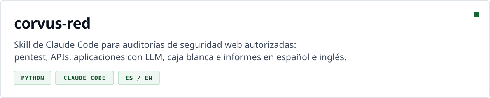
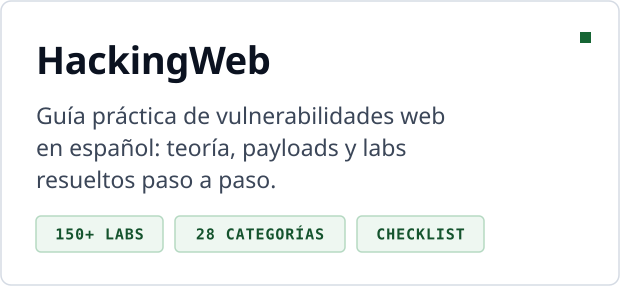
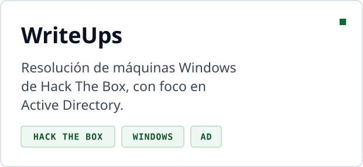

<picture>
  <source media="(prefers-color-scheme: dark)" srcset="assets/cabecera-oscuro.svg">
  
</picture>

 

Me dedico a la seguridad ofensiva: audito aplicaciones web, APIs y entornos de Active Directory para encontrar los fallos antes de que lo haga un atacante.

Llevo 6 años entre desarrollo y seguridad web, con más de 50 aplicaciones revisadas y más de 500 vulnerabilidades encontradas. Aquí publico mis apuntes, writeups y las herramientas que uso en mis auditorías.

## Proyectos

<a href="https://github.com/xn4vi/corvus-red">
  <picture>
    <source media="(prefers-color-scheme: dark)" srcset="assets/corvus-red-oscuro.svg">
    
  </picture>
</a>

<a href="https://github.com/xn4vi/HackingWeb">
  <picture>
    <source media="(prefers-color-scheme: dark)" srcset="assets/hackingweb-oscuro.svg">
    
  </picture>
</a>
<a href="https://github.com/xn4vi/WriteUps">
  <picture>
    <source media="(prefers-color-scheme: dark)" srcset="assets/writeups-oscuro.svg">
    
  </picture>
</a>

## Certificaciones

- **CRTP** · Certified Red Team Professional
- **BSCP** · Burp Suite Certified Practitioner · [verificar](https://portswigger.net/web-security/e/c/b6287e2b9b41aa02)
- **eWPT** · Web Application Penetration Tester · [verificar](https://certs.ine.com/9d23a72b-c800-4225-a53c-6609a8a1f6c0)
- **eJPT** · Junior Penetration Tester · [verificar](https://certs.ine.com/8be2d6d0-2584-475b-96cc-045f19492af9)

## Contacto

<a href="https://ivanperezf.es/"><picture><source media="(prefers-color-scheme: dark)" srcset="assets/boton-web-oscuro.svg"></picture></a>
<a href="https://www.linkedin.com/in/ivanperezf/"><picture><source media="(prefers-color-scheme: dark)" srcset="assets/boton-linkedin-oscuro.svg"></picture></a>
<a href="https://x.com/IvanPerezF_"><picture><source media="(prefers-color-scheme: dark)" srcset="assets/boton-x-oscuro.svg"></picture></a>
